<p align="center">
  
</p>

<p align="center">
  <a href="https://adam-boudjemaa.com"></a>
  <a href="https://www.linkedin.com/in/adam-boudjemaa"></a>
  <a href="https://x.com/AdamBoudj"></a>
</p>

## Web3 x AI

I work where Ethereum standards and AI agents meet: tokenized real-world assets, agent settlement, and the developer tools I use to ship both.

Named author (1 of 5) of ERC-3643, first author of ERC-6960, co-author of ERC-7410, and co-author of ERC-8203, which is still a draft.

I am independent, based in France, and available for work. Previously CTO of Integra (2025 to 2026) and Forward-Deployed AI Engineer at Ilayer (March to August 2026).

- Site: [adam-boudjemaa.com](https://adam-boudjemaa.com)
- Web3 x AI hub: [adam-boudjemaa.com/web3-ai](https://adam-boudjemaa.com/web3-ai)
- All my tools: [adam-boudjemaa.com/tools](https://adam-boudjemaa.com/tools)

## Ethereum standards

| Standard | Role | Links |
|---|---|---|
| [ERC-3643](https://eips.ethereum.org/EIPS/eip-3643) | Named author (1 of 5) | Canonical repo [ERC-3643/ERC-3643](https://github.com/ERC-3643/ERC-3643), educational version [Aboudjem/ERC-3643](https://github.com/Aboudjem/ERC-3643) |
| [ERC-6960](https://eips.ethereum.org/EIPS/eip-6960) | First author | [Aboudjem/ERC-6960](https://github.com/Aboudjem/ERC-6960) |
| [ERC-7410](https://eips.ethereum.org/EIPS/eip-7410) | Co-author | |
| ERC-8203 (draft) | Co-author | Draft PR [ethereum/ERCs#1614](https://github.com/ethereum/ERCs/pull/1614), reference implementation [erc-8203-ref](https://github.com/Aboudjem/erc-8203-ref), billing profile [erc-8203-metered-billing](https://github.com/Aboudjem/erc-8203-metered-billing) |

Also: [solidity-style-guide](https://github.com/Aboudjem/solidity-style-guide), a Solidity style guide with Solhint and Prettier configs and an AGENTS.md.

## Open-source tools

The Claude Code plugins install from one marketplace, [10x](https://github.com/Aboudjem/10x). Inside a Claude Code session:

```text
/plugin marketplace add Aboudjem/10x
/plugin install <name>@10x
```

| Tool | What it does | Install name |
|---|---|---|
| [humanizer-skill](https://github.com/Aboudjem/humanizer-skill) | Finds 55 AI writing patterns and rewrites text in five voice profiles, with an optional 0-100 AI-tell score. Runs locally. | `humanizer@10x` |
| [sniff](https://github.com/Aboudjem/sniff) | Walks your running app's real user flows in a browser and reports what is broken, with proof. Also an MCP server (npm `sniff-qa`). | `sniff@10x` |
| [ui-ux-suite](https://github.com/Aboudjem/ui-ux-suite) | Design audit across 12 dimensions that points to the exact line, the measured value, and the fix. WCAG 2.2 and APCA. | `ui-ux-suite@10x` |
| [goalify](https://github.com/Aboudjem/goalify) | Turns a large task into a brief and a condition for `/goal`, so the run ends with proof it is done. | `goalify@10x` |
| [loopify](https://github.com/Aboudjem/loopify) | Sets up recurring agent jobs that keep a log of what every tick did. | `loopify@10x` |
| [recap-studio](https://github.com/Aboudjem/recap-studio) | Turns a topic or a coding session into an offline, mobile-first explainer page. | `recap-studio@10x` |
| [aws-cost-audit-skill](https://github.com/Aboudjem/aws-cost-audit-skill) | Audits an AWS bill with every number checked against live AWS pricing. Deletes nothing without your approval. | `aws-cost-audit@10x` |
| [secure-my-app](https://github.com/Aboudjem/secure-my-app) | Checks an app against 65 security controls, fixes what fails, and re-runs each check to prove the fix. | `secure-my-app@10x` |
| [contextify](https://github.com/Aboudjem/contextify) | Writes AGENTS.md from repository evidence and checks later whether it is still true. | `contextify@10x` |

Outside Claude Code:

- [Sleepless](https://github.com/Aboudjem/Sleepless): native macOS menu-bar app that keeps a MacBook awake with the lid closed, with an auto-off timer and a battery floor. `brew install --cask aboudjem/tap/sleepless`

## Upstream work

My merged pull requests to other projects are public: [author:Aboudjem is:pr is:merged](https://github.com/search?q=author%3AAboudjem+is%3Apr+is%3Amerged&type=pullrequests).
